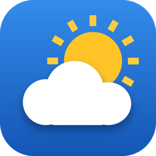
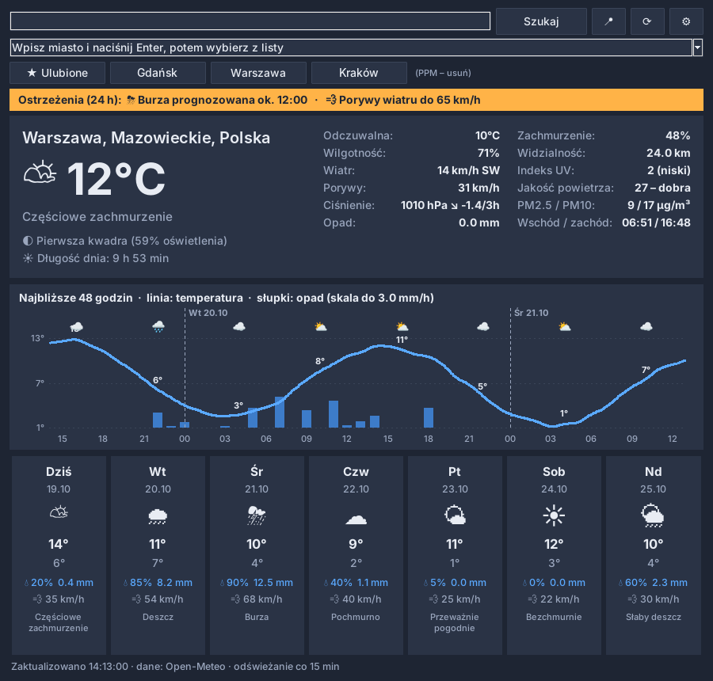

<p align="center"></p>

# Pogoda

Okienkowa aplikacja pogodowa dla Windows (Python + tkinter): wybór miasta, wykres na 48 godzin, prognoza 7-dniowa, jakość powietrza, ostrzeżenia, ikona w zasobniku i widżet na pulpit.

  



<sub>Zrzut z przykładowymi danymi. Na Windows ikony pogody wyświetlają się w kolorze.</sub>

## Funkcje

**Pogoda**
- bieżące warunki: temperatura, odczuwalna, wilgotność, wiatr z kierunkiem, porywy, ciśnienie z trendem (3 h), opad, zachmurzenie, widzialność, indeks UV
- jakość powietrza: europejski indeks AQI oraz PM2.5 / PM10
- wykres najbliższych 48 h: linia temperatury i słupki opadu
- prognoza na 7 dni z prawdopodobieństwem i sumą opadów oraz maksymalnymi porywami
- faza Księżyca, długość dnia, wschód i zachód słońca

**Miasta**
- wyszukiwanie miast z wyborem z listy wyników
- automatyczna lokalizacja na podstawie adresu IP (📍, również przy pierwszym uruchomieniu)
- ulubione miasta jako przyciski szybkiego przełączania (PPM usuwa z listy)

**Ostrzeżenia**
- burze, silne porywy wiatru, przymrozek i duży opad w ciągu najbliższych 24 h
- progi ustawiane w oknie ustawień
- powiadomienie Windows, wysyłane raz dziennie dla każdego typu ostrzeżenia

**Wygoda**
- ikona w zasobniku z aktualną temperaturą; zamknięcie okna minimalizuje aplikację do zasobnika
- tryb widżetu (Ctrl+W): małe okienko zawsze na wierzchu, które można przeciągać; dwuklik przywraca okno
- uruchamianie razem z Windows
- jednostki °C / °F oraz km/h, m/s, węzły, mph
- motyw jasny, ciemny lub zgodny z ustawieniem Windows
- pamięć podręczna: bez internetu aplikacja pokazuje ostatnie dane z adnotacją „nieaktualne”

## Instalacja

### Gotowy plik .exe
Pobierz `Pogoda.exe` z zakładki [Releases](https://github.com/filipdab/Pogoda/releases).

### Ze źródeł
Wymagany jest Python 3.8+. Biblioteki z `requirements.txt` są opcjonalne: włączają ikonę w zasobniku i natywne powiadomienia.

```
pip install -r requirements.txt
pythonw pogoda.py
```

Opcja `--minimized` uruchamia aplikację od razu w zasobniku (z tej opcji korzysta autostart).

### Samodzielne zbudowanie .exe
```
pip install pyinstaller -r requirements.txt
pyinstaller --onefile --noconsole --name Pogoda --icon assets/pogoda.ico --add-data "assets/pogoda.ico;assets" pogoda.py
```

Wypchnięcie tagu `v*` (np. `git tag v2.0.0 && git push --tags`) automatycznie buduje `.exe` przez GitHub Actions i publikuje go w Releases.

## Skróty klawiszowe
| Skrót | Działanie |
|---|---|
| F5 | odśwież |
| Ctrl+W | tryb widżetu |
| Ctrl+, | ustawienia |
| F1 | o aplikacji |
| Ctrl+Q | zakończ |

## Pliki
Ustawienia i pamięć podręczna są zapisywane w `%APPDATA%\PogodaApp\` (`config.json`, `cache.json`). Autostart to wpis w rejestrze `HKCU\Software\Microsoft\Windows\CurrentVersion\Run`.

## Dane
Prognoza, geokodowanie i jakość powietrza: [Open-Meteo.com](https://open-meteo.com) (CC BY 4.0), bez klucza API. Lokalizacja IP: ipapi.co / ipwho.is.

## Autor
Filip · [filipdab@gmail.com](mailto:filipdab@gmail.com) · [github.com/filipdab](https://github.com/filipdab)

Licencja: [MIT](LICENSE)
